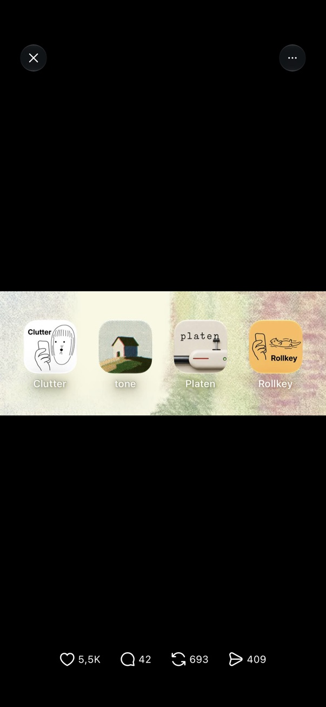
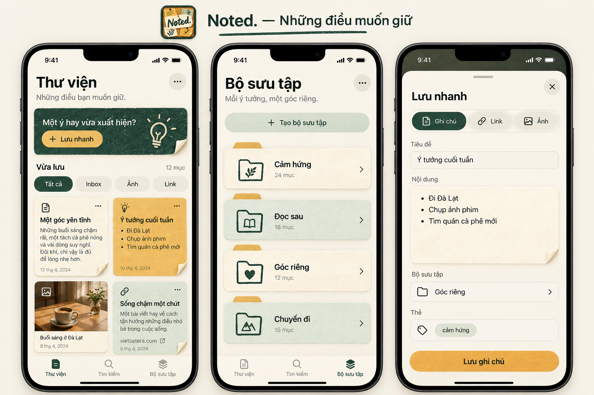
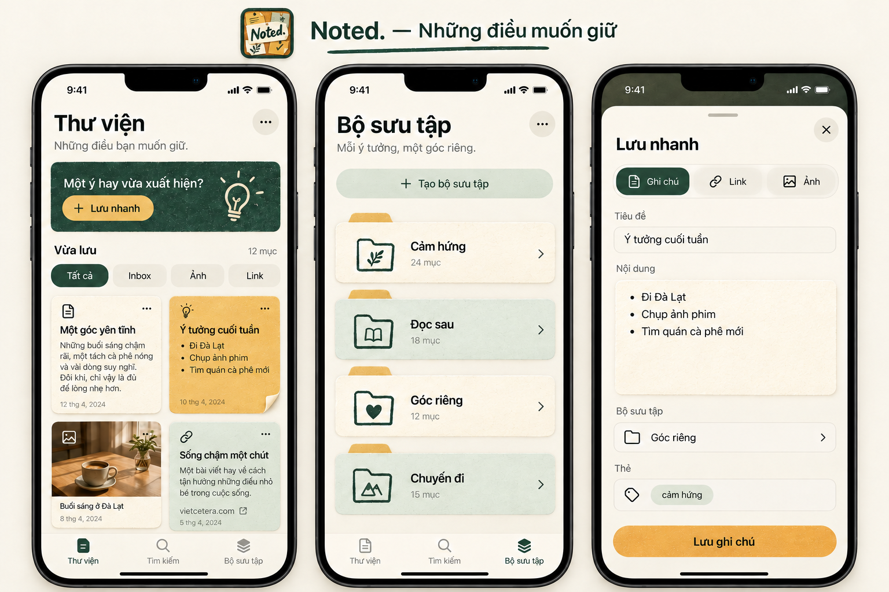

# Noted — Trao đổi thiết kế màu sắc, icon và UI

Ngày xuất: 2026-11-02.

Bản xuất gồm các tin nhắn trao đổi giữa người dùng và trợ lý trong phiên hiện tại. Không bao gồm chỉ dẫn hệ thống, nội dung cấu hình môi trường, mã gọi công cụ hoặc toàn bộ log công cụ. Các ảnh được dẫn bằng đường dẫn tương đối; nội dung prompt tạo ảnh được tóm tắt khi cần. Tin nhắn tiến độ được giữ lại theo diễn biến, một số bước kỹ thuật liên tiếp được gộp để dễ đọc.

## 1. Yêu cầu đổi màu app

**Người dùng:**

> $kit-design Update lại color của app, tôi thấy app đang dùng màu mặc định của AI khiến rất đơn điệu, hãy làm lại màu sắc, sử dụng các skill liên quan tới design, ui-ui-promax, ai-design, ...

Người dùng cung cấp skill `kit-design`, yêu cầu xem thiết kế hiện tại, dùng các skill phù hợp, kiểm tra khả năng sử dụng và cập nhật hướng dẫn thiết kế trong phạm vi triển khai được cho phép.

**Trợ lý — tiến độ:**

> Tôi sẽ dùng `kit-design`, `ui-ux-pro-max` và các nguyên tắc từ `aesthetic` để chọn lại bảng màu phù hợp với app, cập nhật các trạng thái giao diện và kiểm tra độ tương phản cùng hiển thị tiếng Việt.

Sau khi kiểm tra source và design guideline:

> App hiện dùng xanh chàm và tím nhạt ở phần điều hướng lẫn thẻ nổi bật. Tôi chọn hướng **giấy kem, xanh rừng và vàng mật ong** để tạo cảm giác sổ tay cá nhân ấm hơn. Bảng màu sẽ áp dụng cho cả sáng/tối và Share Extension; phần nền xanh viết cứng ở Thư viện cũng sẽ chuyển sang token chung.

## 2. Tạo mockup màu trước

**Người dùng:**

> hãy generate mock trước giúp tôi

**Trợ lý — tiến độ:**

> Tôi sẽ tạo mockup trước để bạn xem hướng màu. Tôi đã chỉnh thử token trong workspace nhưng chưa cài lên iPhone; phần đó vẫn là bản nháp. Tôi dùng thêm skill `imagegen` để tạo mockup Thư viện, Tìm kiếm và Bộ sưu tập theo bảng màu giấy kem, xanh rừng, vàng mật ong.

**Ảnh được tạo:** Board “Noted — Giấy & Rừng”, gồm Thư viện sáng, Bộ sưu tập sáng, Thư viện tối. Ảnh gốc: `exec-c5b49ddb-104b-42aa-bbf5-dba704d6e18b.png` trong thư mục generated_images của phiên.

**Trợ lý:**

> Mockup hướng **“Giấy & Rừng”** gồm Thư viện sáng, Bộ sưu tập và Thư viện tối:
>
> - **Kem giấy** làm nền, tạo cảm giác ấm.
> - **Xanh rừng** cho điều hướng và vùng nổi bật.
> - **Vàng mật ong** nhấn nút “Lưu nhanh”.
>
> Đây là ảnh concept tạo bằng `imagegen` để duyệt hướng màu, chưa phải ảnh app chạy thực tế.

## 3. Chấp thuận màu và yêu cầu bo tròn button

**Người dùng:**

> tôi thích màu này, hãy update lại màu, ngoài ra thì hãy đồng bộ radius của các button, vì đã có pill button rồi nên các button như lưu nhanh, button 3 chấm, ... hãy bo tròn luôn

**Trợ lý — tiến độ:**

> Tôi sẽ áp dụng bảng màu “Giấy & Rừng” đã chọn và đồng bộ các nút sang dáng bo tròn: nút có chữ dùng capsule, nút biểu tượng như dấu ba chấm dùng hình tròn. Tôi sẽ kiểm tra cả app và Share Extension để các nút cùng nhất quán.

> Màu mới đã được áp dụng; “Lưu nhanh”, các nút hành động chung và nút lưu trong Share Extension đã bo dạng pill, nút ba chấm đã thành hình tròn. Các cặp màu chữ/nền chính đều đạt tương phản tối thiểu 4,5:1 ở cả hai chế độ. Tôi đang build lại phiên bản cuối để kiểm tra biên dịch.

**Trợ lý:**

> Đã cập nhật màu **kem giấy – xanh rừng – vàng mật ong** cho app và Share Extension, gồm cả chế độ tối.
>
> - Các nút hành động, gồm **Lưu nhanh** và **Lưu**, dùng dạng pill.
> - Nút **ba chấm** ở Thư viện dùng hình tròn.
> - Giữ bo góc riêng cho card và ô nhập liệu.
>
> **Build iOS thành công**, các cặp màu chữ/nền chính đạt tương phản ≥ 4,5:1. Chưa cài bản mới lên iPhone để kiểm tra trực quan.

Bằng chứng: [Báo cáo build và màu](../evidence/20261102-color-refresh/summary.md).

## 4. Tham khảo phong cách app icon

**Người dùng:**

> $kit-design tôi rất thích app icon trông như này [Image #1] , có thể gen ra app icon trông trông thế này k, hãy dùng các skill bạn có để trả lời

Ảnh tham khảo:

Người dùng cung cấp lại nội dung skill `kit-design`.

**Trợ lý — tiến độ:**

> Được. Các icon trong ảnh có nét minh họa thủ công, chất liệu giấy và hạt màu nhẹ, mỗi icon kể một câu chuyện nhỏ. Tôi sẽ dùng `kit-design`, `aesthetic` và `imagegen` để tạo ba concept riêng cho Noted theo tinh thần đó, kết hợp bảng màu xanh rừng – kem – mật ong bạn đã chọn.

**Ảnh được tạo:** Ba concept icon, gồm bàn tay bỏ giấy vào túi, chiếc tủ hình nhà, mẩu giấy chữ N. Ảnh gốc: `exec-91f07e77-2939-4eaa-be80-be89ec54566e.png`.

**Trợ lý:**

> Tôi đã tạo ba concept theo nét minh họa và chất giấy của ảnh tham khảo:
>
> 1. **Túi ý tưởng** — vui, gần gũi; thể hiện thao tác giữ lại ghi chú.
> 2. **Góc lưu giữ** — chiếc tủ nhỏ như ngôi nhà cho những điều muốn giữ.
> 3. **Mẩu ghi nhớ** — chữ N vẽ tay, đơn giản và dễ nhận diện khi thu nhỏ.
>
> Tôi nghiêng về **02** vì có câu chuyện riêng và hợp tinh thần Noted. Đây là bản concept, chưa thay icon trong app.

## 5. Kết hợp concept 02 và 03

**Người dùng:**

> có thể kết hợp 02 và 03 được k

**Trợ lý — tiến độ:**

> Tôi sẽ kết hợp chiếc tủ hình ngôi nhà của **02** với mẩu giấy chữ **N** của **03**: tờ ghi chú nhô ra khỏi ngăn kéo, giữ chất giấy và màu xanh rừng – mật ong.

**Ảnh được tạo:** Chiếc tủ hình nhà với ngăn kéo mở, tờ giấy chữ N và góc gấp vàng. Ảnh gốc: `exec-680c84b9-09a1-43cb-ba78-76d92407ba53.png`.

**Trợ lý:**

> Đây là bản kết hợp: **chiếc tủ ngôi nhà của 02** giữ **mẩu giấy chữ N của 03**, với góc gấp vàng mật ong.
>
> Chữ N làm điểm nhận diện, còn ngăn kéo kể câu chuyện “giữ lại những điều hay”. Đây vẫn là concept, chưa thay icon trong app.

## 6. Đổi sang icon bảng ghim có chữ Noted.

**Người dùng:**

> k ưng ý lắm, nếu như icon có chữ "Noted.", có tấm bảng ghim và nhiều mẫu giấy nhớ thì sao, vẫn theo concept nét minh họa và chất giấy như trên

**Trợ lý — tiến độ:**

> Tôi sẽ thử một tấm bảng ghim với các mẩu giấy nhớ xếp chồng tự nhiên, chữ **“Noted.”** nổi bật trên mẩu giấy chính. Vẫn giữ nét minh họa thủ công, chất giấy nhám và bảng màu kem – xanh rừng – mật ong, với bố cục gọn để dễ đọc khi thu nhỏ.

**Trợ lý:**

> Bản mới dùng **bảng ghim xanh rừng**, các mẩu giấy nhớ kem – vàng – xanh sage, cùng chữ **“Noted.”** viết tay làm điểm chính.
>
> Vẫn giữ chất giấy nhám, nét vẽ thủ công và góc giấy cong nhẹ. Đây là concept để duyệt, chưa thay icon trong app.

## 7. Chọn icon và yêu cầu mockup UI đồng bộ

**Người dùng:**

> tuyệt vời, chọn icon này, ngoài ra với concept là chất giấy nhám, nét vẽ thủ công và góc giấy cong nhẹ, có thể update lại UI bên trong app được k, tạo mock trước

**Trợ lý — tiến độ:**

> Tôi sẽ giữ mẫu bảng ghim này làm icon đã chọn và dùng `kit-design`, `aesthetic`, `ui-ux-pro-max` cùng `imagegen` để tạo mockup UI tương ứng. Chất giấy nhám, nét vẽ tay và góc giấy cong sẽ xuất hiện nhẹ trên thẻ nội dung; chữ và các nút pill vẫn rõ ràng, dễ thao tác.

**Trợ lý:**

> Mockup gồm **Thư viện, Bộ sưu tập và Lưu nhanh**:
>
> - Thẻ nội dung mang chất giấy nhám, góc cong nhẹ.
> - Bộ sưu tập giống những bìa hồ sơ giấy.
> - Nét vẽ tay dùng ở biểu tượng và điểm nhấn; chữ nội dung vẫn rõ ràng.
> - Giữ nút pill và nút biểu tượng tròn.
>
> Đã lưu **icon bảng ghim bạn chọn**. Đây là mockup UI để duyệt, chưa áp dụng vào app.

## 8. Giảm góc giấy cong và đồng nhất chiều rộng pill

**Người dùng:**

> nhiều  góc giấy cong nhẹ quá, hãy random 1 vài cái thôi, ít ít k nhiều, ngoài ra mặc định các pill button cần đồng nhất về width

**Trợ lý — tiến độ:**

> Tôi sẽ chỉnh mockup để chỉ vài thẻ có góc giấy cong, đặt rải rác và giữ phần lớn thẻ phẳng. Các nút pill cùng nhóm sẽ có chiều rộng bằng nhau, như nhóm bộ lọc và nhóm Ghi chú / Link / Ảnh.

**Trợ lý:**

> Đã chỉnh mockup v2:
>
> - Chỉ giữ **một góc giấy cong** ở thẻ vàng, phần lớn thẻ phẳng.
> - Các pill **cùng nhóm có chiều rộng bằng nhau**, không phụ thuộc độ dài nhãn.
> - Giữ chất giấy nhám và nét minh họa.
>
> Khi triển khai, các góc cong sẽ xuất hiện thưa và cố định theo từng thẻ, tránh đổi ngẫu nhiên mỗi lần mở.

## 9. Ba nút chế độ Lưu nhanh cũng phải là pill

**Người dùng:**

> 1 chỗ cần update, tại lưu nhanh, 3 button "ghi chú" , "link", "ảnh" cũng sẽ là pill button

**Trợ lý — tiến độ:**

> Tôi sẽ chỉnh riêng ba nút **Ghi chú / Link / Ảnh** thành ba pill độc lập, rộng bằng nhau và bo tròn hoàn toàn ở hai đầu.

**Trợ lý:**

> Đã cập nhật mockup v3: **Ghi chú / Link / Ảnh** là ba pill riêng biệt, rộng bằng nhau, có khoảng cách và bỏ khung bao chung.

## 10. Yêu cầu xuất cuộc trao đổi

**Người dùng:**

> export đoạn chat ra 1 file md được k

**Trợ lý — tiến độ:**

> Tôi sẽ xuất cuộc trao đổi thành một file Markdown trong thư mục `docs`, kèm đường dẫn đến các mockup và icon đã tạo.

## Trạng thái tại thời điểm xuất

- Đã triển khai bảng màu Giấy & Rừng và bo tròn các nút hành động trong source; build iOS thành công, chưa cài bản mới lên iPhone trong phiên này.
- Người dùng đã chọn icon bảng ghim có chữ **Noted.**; ảnh đã lưu, chưa thay asset icon sản xuất.
- UI chất giấy đang ở bước mockup. Bản mới nhất là **v3**; chưa triển khai texture, góc giấy cong hay thiết kế hồ sơ giấy vào SwiftUI.
- Các pill cùng nhóm phải có chiều rộng đồng nhất. Riêng Ghi chú / Link / Ảnh là ba pill độc lập.
- Góc giấy cong dùng rất ít, rải rác ổn định theo thẻ.

Tài liệu liên quan: [Ghi chú concept](../design-preview/paper-concept.md), [Design guideline](../design-guideline.md).
